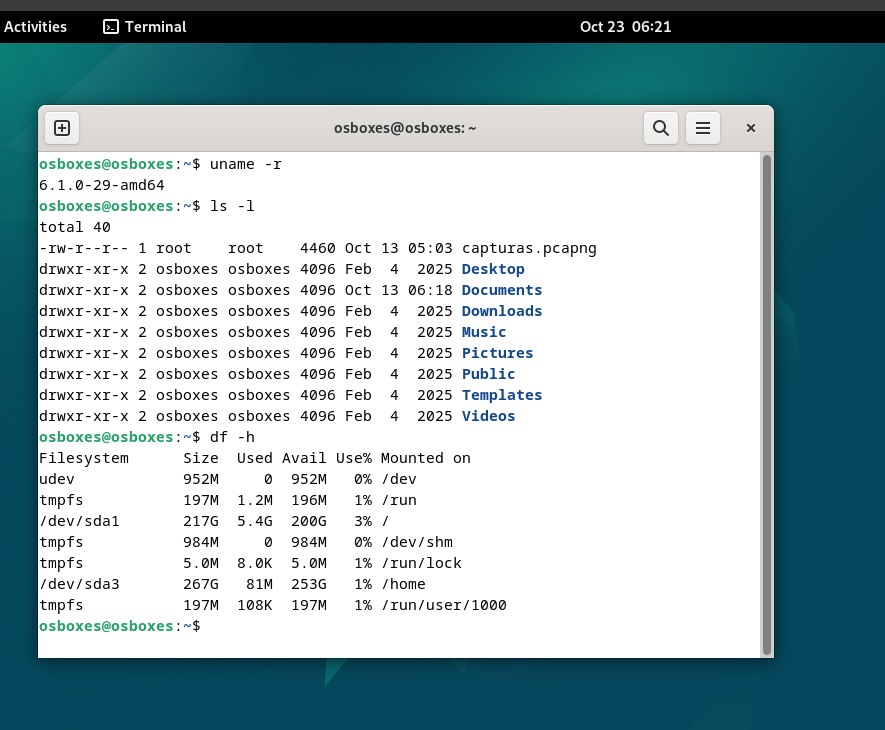

# 🐧 Introducción a Linux

> *"Hablar es barato. Enséñame el código."* — Linus Torvalds

Documento elaborado como ejercicio de **Markdown** para el ciclo ASIR.

---

## 🧠 ¿Qué es Linux?

**Linux** es un sistema operativo de *código abierto* basado en el núcleo (kernel) creado por **Linus Torvalds** en 1991. Hoy se utiliza en servidores, teléfonos Android, routers y superordenadores. Para ver la versión del kernel que usas puedes ejecutar `uname -r` en la terminal.

### Ventajas principales

- **Gratuito** y de código abierto.
- **Seguro** y estable.
- **Personalizable** al máximo.
- Gran **comunidad** de soporte.

---

## 💻 Comandos básicos

Algunos comandos que todo administrador de sistemas debe conocer:

```bash
# Listar archivos con detalle
ls -l

# Crear una carpeta
mkdir proyectos

# Entrar en la carpeta
cd proyectos

# Crear un archivo y ver su contenido
echo "Hola Linux" > notas.txt
cat notas.txt

# Ver el espacio en disco
df -h
```

---

## 🧩 Distribuciones

### Distribuciones populares

- Ubuntu
- Debian
- Fedora
- Arch Linux

### Pasos para instalar Ubuntu

1. Descargar la imagen **ISO** desde la web oficial.
2. Crear un **USB booteable**.
3. Arrancar el equipo desde el USB.
4. Seguir el **asistente de instalación**.
5. Reiniciar y empezar a usar el sistema.

---

## 🔗 Recursos y enlaces

- Web oficial del kernel: [kernel.org](https://www.kernel.org)
- Más información en el fichero secundario: [Ver detalles](docs/detalles.md)

---

## 🖼️ Imágenes

### Imagen local (captura de mi terminal)



### Imagen externa (Wikimedia Commons)


---

## 📊 Tabla comparativa

| Distribución | Basada en     | Uso recomendado         | Dificultad |
|--------------|---------------|-------------------------|------------|
| Ubuntu       | Debian        | Escritorio y servidores | Baja       |
| Fedora       | Red Hat       | Desarrolladores         | Media      |
| Debian       | Independiente | Servidores estables     | Media      |
| Arch Linux   | Independiente | Usuarios avanzados      | Alta       |

---

*Autor: durgaxxi · Ejercicio de Markdown · ASIR*
